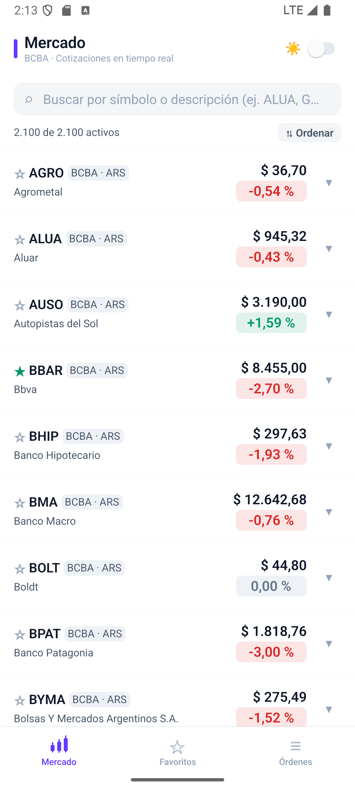
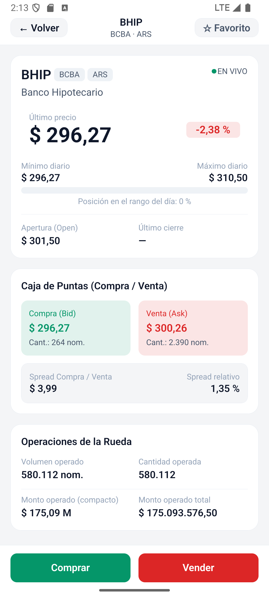
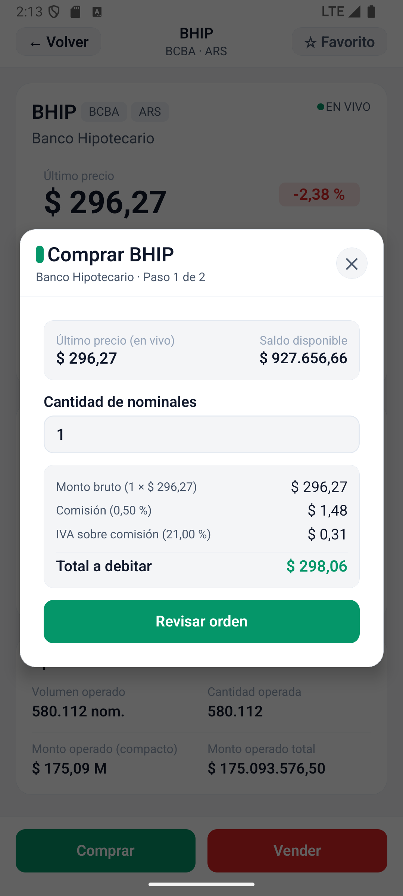
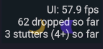

# 📈 CHALLENGE TÉCNICO - MOBILE · REACT NATIVE - Mercado de activos

> Una app de mercado con precios en vivo, favoritos y simulador de órdenes, construida con IA.

## 📸 Screenshots

| Mercado (Listado & Streaming) | Detalle de Activo | Simulación de Órdenes |
| :---: | :---: | :---: |
|  |  |  |

---

## 🚀 Quick Start (Cómo correr la app)

Asegúrate de haber completado la [Guía de Entorno de React Native](https://reactnative.dev/docs/set-up-your-environment) antes de continuar.

### 1. Clonar e instalar dependencias

```bash
git clone https://github.com/AleBattista/ReactNativeChallenge.git
cd ReactNativeChallenge
npm install
```

### 2. Dependencias nativas

```bash
# Solo para iOS
bundle install
bundle exec pod install
```

### 3. Ejecutar la aplicación

```bash
# En iOS
# Opcional: Levantar Metro en una terminal paralela si el CLI no lo inicia automáticamente
npm start

# En otra terminal:
npm run ios
```

```bash
# En Android
# Opcional: Levantar Metro en una terminal paralela si el CLI no lo inicia automáticamente
npm start

# En otra terminal:
npm run android
```

## 🏛️ Decisiones Técnicas y Arquitectura

Voy a detallar las decisiones más importantes de la arquitectura y el diseño de la app con las cuales me fui encontrando a medida que iba pensando el desarrollo:

- **Estructura de Capas (Clean Architecture):** Lo primero que busqué fue una forma ya probada y concisa de organizar el proyecto. Elegí **Clean Architecture** porque tengo experiencia desarrollando apps con esta base y aporta una separación de capas muy clara, dejando la aplicación lista para escalar directamente en producción.

- **El desafío del rendimiento con 2.000+ datos en tiempo real:** El segundo de los temas que tuve que decidir fue: ¿cómo tener más de 2.000 datos actualizándolos cada pocos segundos sin saturar el hilo de JavaScript y que la app quede congelada?
  - ¿Había posibilidad de usar **SQLite**? No, hacer inputs y outputs en disco degradaría el rendimiento y la batería innecesariamente.
  - ¿Guardar en **Redux, Zustand o alguna local store**? Claramente no, esto saturaría las entradas al store y provocaría re-renders masivos lo cual rompería la app por completo.
  - ¿Guardar en memoria **fuera del árbol de React** los datos? **SÍ**, y explico por qué:
    - Guardar en memoria los datos dentro del hilo de JavaScript tiene muchísimas ventajas porque los inputs y reescrituras se hacen directamente en memoria, lo cual es ultra rápido y no necesitamos que persistan (son datos fugaces que no hace falta guardar), evitando saturar el hilo de JavaScript y la UI.
    - ¿Por qué fuera del árbol de React? Porque no necesitamos que React se entere de estos micro-cambios, ni que sus hooks reaccionen a estos.

- **Suscripción granular y renderizado selectivo:** Otra de las decisiones importantes fue que, teniendo estos datos en memoria (`Map`), ¿cómo hago para que la UI se entere de estos cambios sin hacer re-renders masivos?
  - La solución fue **suscribirse celda por celda y ticker por ticker** al buffer mediante `useSyncExternalStore` suscribiéndose al mismo.
    Al aislar la suscripción dentro de cada celda y envolverla con `React.memo`, cuando cambia una cotización se re-renderiza únicamente esa celda específica, logrando que el resto de la lista y la pantalla general ni se enteren de que algo cambió.

- **El rol clave de FlashList:** Para esto mismo ayudó muchísimo **FlashList**. ¿Por qué ayudó? Porque está optimizada para reciclar las vistas y mantiene activos únicamente los listeners de las celdas que están en el viewport del usuario. Esto hace que, si tengo una lista de 2.000 tickers y el usuario solo ve aprox. 20 en pantalla, por más que se hayan actualizado 1.000 precios en memoria, el motor de suscripciones solo empuja esos re-renders a los 20 visibles, ahorrando cientos de re-renders innecesarios.
  - _Nota importante:_ **Solo se suscribe a los cambios de precios**, mientras que la metadata estática de los activos (nombre, ticker, tipo) permanece intacta, lo cual hace todo muchísimo más liviano.

- **Persistencia de estado de negocio:** A diferencia de las cotizaciones en vivo, los datos propios del usuario sí necesitaban mantenerse guardados entre sesiones (`PortfolioStore`, `FavoritesStore`, `OrderStore`, el saldo disponible y la preferencia de tema dark/light). Para esto simplemente aproveché Zustand con su middleware `persist` (`createJSONStorage` + `AsyncStorage`), que resuelve el guardado local de forma limpia y sin boilerplate innecesario.

* **Bloqueo de cotización (_Price Lock_) al cargar una orden:** Hoy decidí mantener el `OrderModal` suscribiéndose en tiempo real al precio del activo mientras el usuario carga los datos, ejecutando la orden al último valor disponible al confirmar. Esto hace que el precio se actualice hasta el último momento en el que el usuario presiona confirmar. Para el alcance del challenge funciona bien y simplifica el flujo, pero en una siguiente iteración lo mejoraría agregando un _Price Lock_ (lo detallo más abajo en _"Qué quedó afuera y Cómo lo encararía"_).

* **Pausa en segundo plano (_AppState_):** Para no mantener el feed activo sin necesidad cuando la app pasa a background, sumé un listener de `AppState` que pausa las actualizaciones mientras no está en primer plano y refresca lo visible al volver.

## ⚡ Rendimiento y Métricas (Performance)

Para asegurar que la arquitectura de streaming atómico cumpla con los estándares de fluidez requeridos en una app financiera, sometí la aplicación a pruebas de estrés con el catálogo completo de **2.100+ activos**, streaming continuo en vivo y scroll rápido simultáneo.

### Cómo lo medí

- **React Native Performance Monitor:** Para monitorear en tiempo real los cuadros por segundo (FPS) en el hilo nativo (**UI**) y en el hilo de negocio (**JS**).
- **React DevTools Profiler:** Para inspeccionar los ciclos de commit, validar que no existan re-renders en cascada y medir el costo en milisegundos de cada actualización.

### Resultados obtenidos
* **Fluidez en UI:** Cercana a 60 FPS en pruebas de estrés con el catálogo completo, streaming continuo y scroll intensivo en modo desarrollo/emulador. Como el contador del monitor es acumulado durante toda la sesión, es esperable que los *dropped frames* (cuadros sueltos que no llegan a tiempo) y los *stutters (4+)* (trabones más notorios de 4 o más cuadros seguidos) suban con los minutos de uso y navegación (por ejemplo, tras ~10 minutos de prueba continua). En la práctica, el movimiento se mantiene fluido y sin bloqueos prolongados.
* **Costo de Renderizado:** Cada commit de actualización de cotizaciones toma menos de 4 ms (muy por debajo del límite de 16,6 ms que tenemos por cuadro para sostener 60 FPS), dejando margen libre para responder al scroll y a la interacción del usuario.
* **Eficiencia de Suscripción:** El Flamegraph confirma que ante actualizaciones masivas en memoria, solo se re-renderizan las celdas visibles en el *viewport* cuyo precio varió, evitando trabajo innecesario en el resto de la lista.

| React DevTools Profiler (Aislamiento & ms) |     Performance Monitor (60 FPS en vivo)      |
| :----------------------------------------: | :-------------------------------------------: |
| _(Insertar screenshot del Profiler aquí)_  |  |

## 🔭 Qué quedó afuera y Cómo lo encararía

Para cumplir con el alcance del challenge priorizando una arquitectura sólida y 60 FPS estables, dejé afuera algunas mejoras puntuales que encararía en una siguiente iteración:

- **Bloqueo de precio (_Price Lock_) en la carga de órdenes:** Hoy la orden de compra/venta sigue actualizando su valor en tiempo real mientras el usuario ingresa los datos. En una siguiente iteración, al pasar a la pantalla de revisión congelaría la cotización por una ventana corta (ej. 15 segundos) o mostraría un aviso de confirmación si el precio se mueve brusco antes de confirmar la operación.
- **Pulido visual y gráficos en tiempo real:** Prioricé la fluidez y la arquitectura por sobre el diseño visual avanzado. Con más tiempo, trabajaría en una estética más distintiva (mayor jerarquía tipográfica, cards con más aire y menos bordes rígidos) e incorporaría un gráfico intradiario.
- **Tests End-to-End (E2E):** Si bien la lógica del motor y el dominio cuentan con pruebas unitarias, sumaría flujos automatizados para validar de punta a punta el recorrido crítico (buscar un activo, agregarlo a favoritos y completar una orden).
- **Separación de estilos y revisión de inline styles:** Para evitar que pantallas (como por ejemplo OrdersScreen) se vuelvan demasiado largas, sería conveniente sacar los estilos a archivos dedicados y repasar que no queden estilos inline sueltos en toda la app, manteniendo la lógica visual bien ordenada y más liviana de leer.
- **Mejoras de UX en la carga de órdenes y flujos clave:** Para mí la UX es fundamental —especialmente al operar, donde cualquier fricción puede generar errores o dudas—, pero en este alcance prioricé la base técnica y el rendimiento. Un ejemplo concreto es la carga de cantidad en las ordenes de compra/venta: hoy se resuelve con un input directo, y en una siguiente iteración sumaría controles más ágiles como chips de porcentajes rápidos (ej. 25%, 50%, 100% del saldo o tenencia), cálculo bidireccional entre monto y nominales o feedback más claro antes de confirmar.

## 📂 Documentación Extendida y Arquitectura (/docs)

Para mantener el README principal ágil y enfocado en el código y el Quick Start, toda la documentación técnica profunda, decisiones de diseño y diagramas se encuentran en la carpeta `/docs`:

- **`docs/ARCHITECTURE.md`:** Detalle completo de la separación de capas, contratos de servicios, el funcionamiento del buffer en memoria y la sincronización con `useSyncExternalStore`.
- **`docs/AI_DEVELOPMENT_LOG.md`:** El registro y los chats de iteración con la inteligencia artificial durante el diseño de la app, mostrando cómo se plantearon y resolvieron los cuellos de botella de rendimiento.
- **`docs/DESIGN_SYSTEM.md`:** Guía rápida de colores, tipografías y componentes reutilizables utilizados para mantener la consistencia visual sin tocar lógica.
