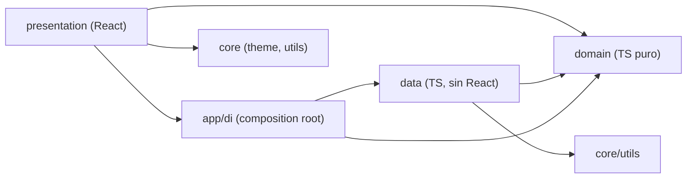
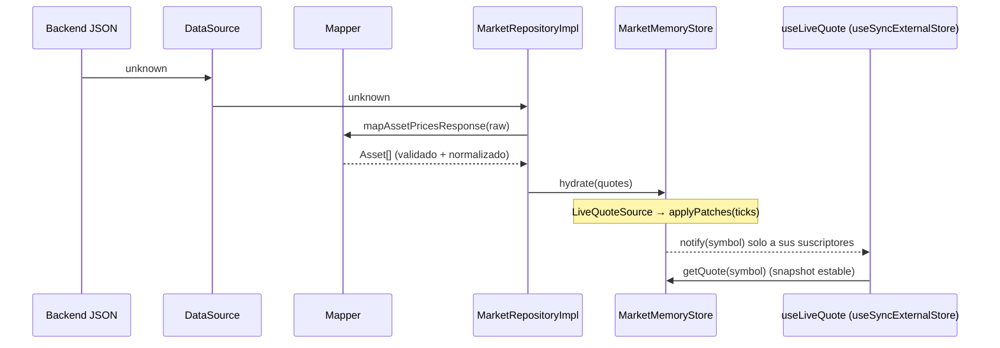

# Arquitectura

Clean Architecture con tres capas + `core` (transversal) + `app` (composition root).



**La regla de dependencia:** `domain` no importa nada. `data` implementa interfaces de `domain`. `presentation` solo ve interfaces de `domain`, que recibe por DI. ESLint hace cumplir esto (`no-restricted-imports` en `.eslintrc.js`).

## Estructura

```
src/
├── app/                         # Composition root (lo único que conoce implementaciones concretas)
│   ├── di/                      # container.ts (wiring) + DependenciesProvider.tsx
│   └── navigation/              # (próximo paso)
├── core/
│   ├── theme/                   # tokens.ts → themes.ts (light/dark semánticos) → ThemeProvider
│   └── utils/                   # numbers.ts (saneo) + formatters.ts (es-AR, financieros)
├── domain/                      # TypeScript puro: sin React/RN
│   ├── shared/                  # Result, DomainError, Ticker, Currency, Unsubscribe
│   ├── market/
│   │   ├── entities/            # AssetInfo, Asset, Quote (+ getTrend, getSpread)
│   │   ├── repositories/        # MarketRepository, QuoteFeed (puertos)
│   │   └── usecases/            # (próximo paso)
│   ├── orders/                  # Order (unión discriminada MARKET|LIMIT), OrderRequest, OrderRepository
│   └── portfolio/               # Portfolio, Position, CashBalance, PositionValuation, PortfolioRepository
├── data/                        # Implementaciones; sin React
│   ├── market/
│   │   ├── dto/                 # AssetPriceDto (espejo del JSON) + type guards
│   │   ├── mappers/             # DTO → entidad (normaliza 0/null)
│   │   ├── datasources/         # MarketRemoteDataSource (Http/Mock), LiveQuoteSource, fixtures/
│   │   ├── store/               # MarketMemoryStore (singleton de precios en vivo)
│   │   └── repositories/        # MarketRepositoryImpl
│   ├── orders/                  # (próximo paso)
│   └── portfolio/               # (próximo paso)
└── presentation/
    ├── shared/
    │   ├── components/          # AppText, Card, ChangeBadge (presentacionales, sin lógica)
    │   └── hooks/
    ├── market/
    │   ├── hooks/               # useLiveQuote, useLiveQuoteSelector, useMarketSymbols
    │   ├── components/
    │   └── screens/
    ├── orders/
    └── portfolio/
```

## Flujo de datos



## Normalización del JSON crudo

| Campo crudo | Problema | Dominio |
|---|---|---|
| `ultimoCierre: 0` (ALUA) | 0 = "sin dato", no precio real | `previousClose: null` |
| precios `<= 0` / `null` | idem | `null` |
| `tasaCompra/Venta: 0`, `tir: null` en acciones | sin sentido para equity | `quote.yield: null` |
| `volumenOperado: 0` con `montoOperado > 0` (AGRO) | inconsistencia del backend | se expone tal cual (no se inventan datos) |
| `variacionDiaria: null` | falta | se deriva de `lastPrice` vs `previousClose` |
| moneda desconocida / tipos inválidos | contrato roto | item descartado, se cuenta en `rejected` |
| `maturityDate` / `tir` presentes | renta fija | `instrumentType: 'FIXED_INCOME'` |

## MarketMemoryStore: estrategia

1. **Fuera de React:** los precios nunca pasan por `useState` ni Context. Un tick no re-renderiza el árbol.
2. **Suscripciones por símbolo:** `Map<Ticker, Set<Listener>>`. Un tick de ALUA solo despierta a quienes observan ALUA.
3. **Inmutabilidad estructural:** solo se reemplaza el objeto `Quote` que cambió. `getQuote` devuelve una referencia estable, como exige `useSyncExternalStore`.
4. **Dedupe + batching:** los parches sin cambio real no notifican, y N ticks en el mismo turno generan 1 notificación por símbolo (el scheduler se puede inyectar para tests o para un throttle con rAF).
5. **Singleton controlado:** la instancia de módulo solo la importa `app/di`. El resto la recibe tipada como `QuoteFeed`, la interfaz de dominio, así que en tests se puede reemplazar.
6. **Granularidad por campo:** `useLiveQuoteSelector(symbol, q => q?.lastPrice)` re-renderiza solo si cambia ese valor.
